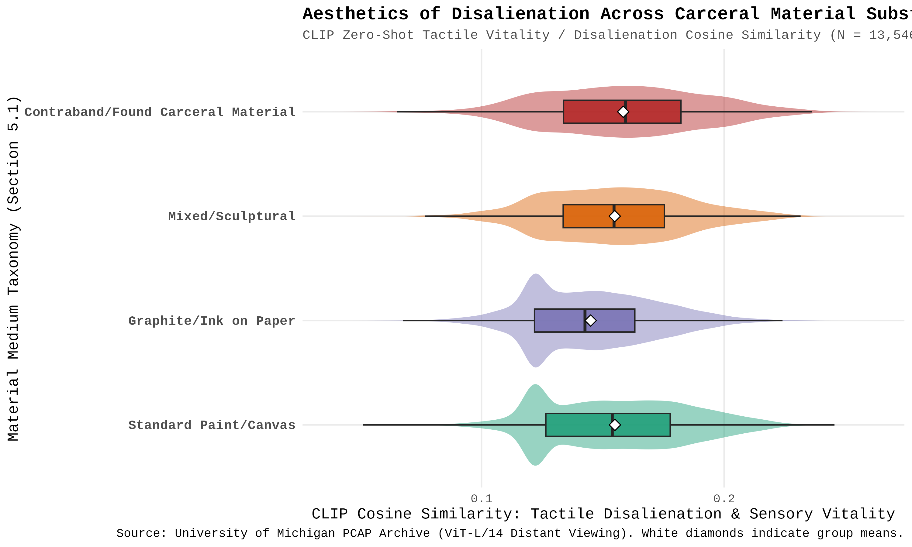
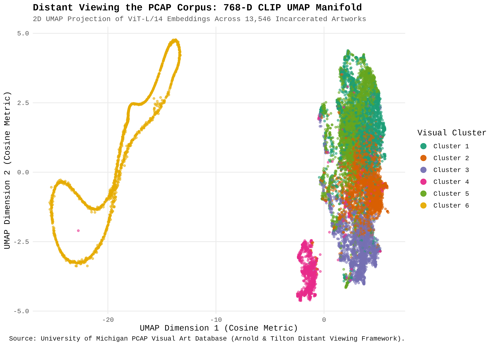
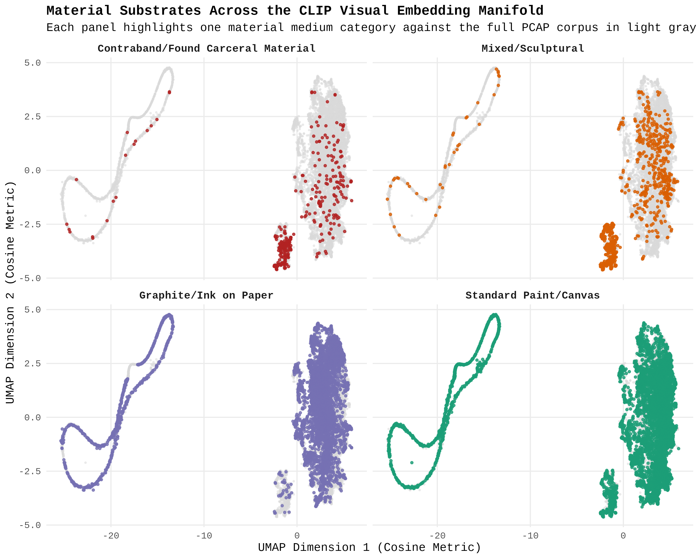
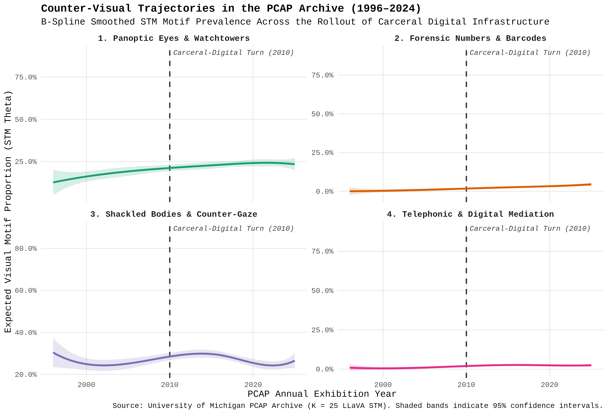
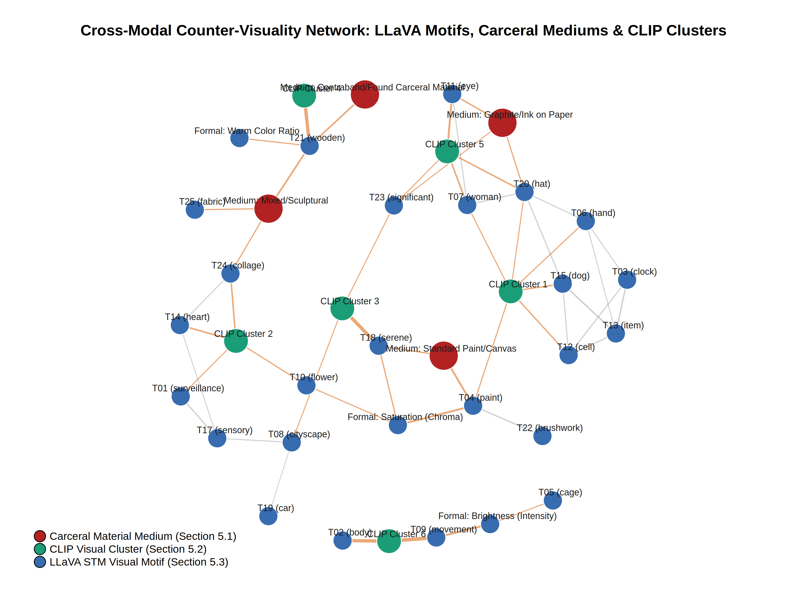
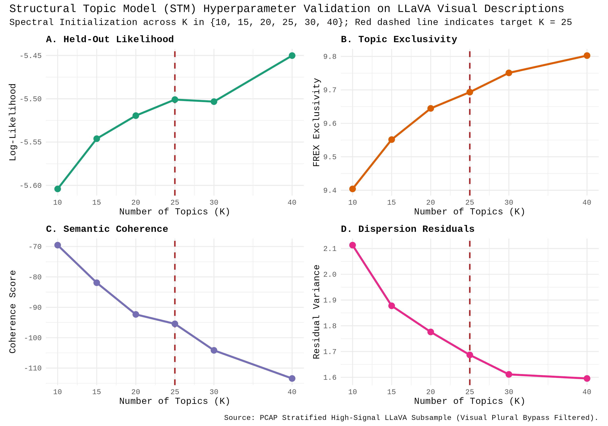

# Counter-Visuality in the Carceral Archive: Distant Viewing and Multimodal Interrogation of the Prison Creative Arts Project (PCAP)

[](https://colab.research.google.com/github/chayne-wild/PCAP-CLIP-and-LLaVA/blob/main/PCAP_CLIP_and_LLaVA.ipynb)


An end-to-end multimodal computer vision, Vision-Language Model (VLM) iconographic interrogation, and **Structural Topic Modeling (STM)** replication pipeline analyzing **13,546 artworks** (**768-D `OpenCLIP ViT-L/14` visual embeddings** across the full corpus and **2,174 `LLaVA-1.5-7B` iconographic transcripts** spanning **1,181 filtered visual lemmas**) from the University of Michigan **Prison Creative Arts Project (PCAP)** Visual Art Database (1996–2025).

Built for **Google Colaboratory** using an integrated Python-to-R `rpy2` (`%%R`) bridge and open-weights models hosted on the **Hugging Face Hub**, this repository provides a unified, deterministic, and fault-tolerantly checkpointed sequential replication notebook (`PCAP_CLIP_and_LLaVA.ipynb`). The pipeline spans polite Omeka S REST API metadata indexing (`01`), ephemeral RAM image streaming and contrastive CLIP distant viewing (`02`), 4-bit NormalFloat (`NF4`) quantized LLaVA visual interrogation (`03`), tidy metadata normalization and cosine UMAP manifold projection (`04`), "Visual Plural Bypass" NLP preprocessing and STM hyperparameter tuning (`05`), deterministic $K = 25$ spectral STM estimation (`06`), B-spline temporal and post-2010 surge-era OLS regressions (`07`), cross-modal `igraph` network topology (`08`), and joint CLIP–LLaVA exemplar extraction for close art-historical reading (`09`).

---

## 1. Project Overview & Hypothesis Framework

**Driving Research Question:** *How do incarcerated artists in the Prison Creative Arts Project (PCAP) archive deploy material substrates and visual iconography to combat carceral sensory deprivation ("disalienation") and stage a "counter-visuality" against panoptic, bureaucratic, and digital regimes of prison control?*

Drawing together **Frantz Fanon and François Tosquelles's** institutional psychotherapy of *disalienation*, **Taylor Arnold and Lauren Tilton's (2023)** computational *Distant Viewing* framework, and **Nicholas Mirzoeff's (2011)** and **Simone Browne's (2015)** theorizations of *counter-visuality* and *biometric surveillance*, this project tests a **Master Hypothesis of Carceral Counter-Visuality**: that incarcerated artists do not passively reflect institutional confinement, but actively repurpose carceral materials and visual forms to reclaim bodily sovereignty and subvert the optical and digital architectures of the prison.

To render this claim computationally falsifiable across 13,546 unlabelled artworks, the pipeline evaluates three operational sub-hypotheses:

1. **$H_1$ — The Material Disalienation Hypothesis (Section 5.1):**
   Artworks fabricated from **contraband, found, or salvaged carceral substrates** (e.g., carved prison soap, toilet paper, state bureaucratic forms, candy wrappers, salvaged bedsheets, yard twigs, plastic TV screens) will exhibit significantly higher visual and tactile vitality (*disalienation*) than standard studio or dry-drawing media, whereas accessible dry media (**graphite and ballpoint ink on paper**) will serve as the primary forensic vehicle for direct figurative confrontation, portraiture, and bureaucratic critique.
2. **$H_2$ — The "Carceral-Digital Turn" Surge Hypothesis (Section 5.4):**
   The rollout of privatized digital telecommunications, video visitation monitors, electronic tablets (e.g., JPay JP5/JP6), and biometric tracking across correctional facilities circa **2010** catalyzed a structural shift in prisoner iconography. Counter-visual motifs—*Panoptic Eyes & Watchtowers*, *Forensic Numbers & Barcodes*, and *Telephonic/Screen Separation*—will exhibit a statistically significant upward trajectory across the 1996–2024 archive and heightened prevalence during the post-2010 Carceral-Digital Turn, strongly coupled with assertions of bodily autonomy.
3. **$H_3$ — The Cross-Modal Structural Coupling Hypothesis (Sections 5.2–5.3):**
   Low-level Human-Computer Interaction (HCI) formal metrics (brightness/intensity, color chroma/saturation, warm-color pixel ratio), continuous 768-D CLIP embedding clusters, physical material substrates, and high-level LLaVA semantic motifs form a statistically coupled, multipartite network in which material scarcity and formal choices structurally anchor counter-visual themes.

---

## 2. Summary of Key Empirical Findings

### 1. Aesthetics of Disalienation Across Carceral Material Substrates ($H_1$)
Classifying all $N = 13,546$ artworks into a 4-part Carceral Materiality Taxonomy (`Step 04`) and evaluating zero-shot `OpenCLIP ViT-L/14` cosine similarities confirms a highly significant divergence across material substrates (**Kruskal-Wallis $H = 360.840, p = 6.7032 \times 10^{-78}$**; see [`results/charts/table01_pcap_medium_taxonomy.csv`](results/charts/table01_pcap_medium_taxonomy.csv)):



* **Tactile Vitality in Contraband & Salvaged Substrates:** Artworks crafted from **Contraband/Found Carceral Materials** ($n = 353$, $2.61\%$ of the archive) achieve the **highest mean raw Tactile Disalienation score ($0.1584 \pm 0.0321$)** of any medium in the archive and a strongly positive net Composite Disalienation Index ($+0.1692$). Stripped of formal studio supplies, incarcerated artists transform institutional detritus (soap, toilet paper, wrappers, state forms, magazines) into objects of high sensory vitality.
* **The Functional Division of Labor Between Studio Paint and Forensic Graphite/Ink:**
  * **Standard Paint/Canvas** ($n = 7,029$, $51.89\%$) achieves the highest net Composite Disalienation Index ($+0.2141$; raw tactile score $0.1550$) due to its concentration in lush pastoral landscapes, wildlife, and open horizons.
  * **Graphite/Ink on Paper** ($n = 5,240$, $38.68\%$) exhibits the lowest raw tactile disalienation ($0.1450$) and a negative net Composite Disalienation Index ($-0.3155$) precisely because ballpoint pen, pencil, and charcoal on paper serve as the primary medium for **direct human portraiture (`mean_bodily_autonomy` = $0.1622$, #1 in archive)** and **state bureaucratic critique (`mean_bureaucracy_score` = $0.1675$, #1 in archive)**.

### 2. Macro-Topology of the 768-D CLIP UMAP Manifold ($H_1$ & $H_3$)
Projecting the $13,546 \times 768$ L2-normalized CLIP matrix into 2D via cosine UMAP (`uwot::umap`, `n_neighbors = 30`, `min_dist = 0.12`) alongside $K = 6$ K-means clustering ([`results/charts/table02_cluster_prompt_profiles.csv`](results/charts/table02_cluster_prompt_profiles.csv)) and Arnold & Tilton's (2023, p. 210) small-multiple grey-background facet design reveals three distinct geometric regimes:



* **The Main 2D Iconographic Continent ($\text{UMAP}_1 \in [0, 6]$):** Organizes 2D artworks along a vertical gradient from **Cluster 1** ($20.38\%$, carceral containment, Disalienation Index $= -0.5088$) and **Cluster 5** ($21.53\%$, close-up portraiture and bodily autonomy $= 0.1715$), through **Cluster 2** ($20.29\%$, highest panoptic surveillance $= 0.1449$, digital mediation $= 0.1491$, and state bureaucracy $= 0.1739$), down to **Cluster 3** ($17.16\%$, the pastoral disalienation pole, Disalienation Index $= +1.0974$).
* **The 3D Sculptural & Contraband Assemblage Island (Cluster 4, $7.94\%, n = 1,076$):** Situated at $\text{UMAP}_1 \in [-3, 0], \text{UMAP}_2 \in [-4.8, -2.5]$. As shown in the faceted small-multiple projection below, **Contraband/Found Carceral Material** and **Mixed/Sculptural** works concentrate densely inside this island, demonstrating that `ViT-L/14` cleanly separates 3D sculptural objects and assemblages from 2D flat scans.
* **The Serpentine Dynamic-Flight Filament (Cluster 6, $12.69\%, n = 1,719$):** Situated on the far left ($\text{UMAP}_1 \in [-25, -14]$), capturing isolated subjects in dynamic motion/flight against uniform backgrounds (correlating at $r = +0.6988$ with STM Topic 09 `movement/flight/wingspan` and $r = +0.6435$ with Topic 02 `bird/water/wing`).



### 3. Temporal Trajectories & The 2010 Carceral-Digital Turn ($H_2$)
Evaluating B-spline smoothed STM motif prevalence (`stm::estimateEffect`), half-decade aggregations ([`results/charts/table04b_half_decade_trends.csv`](results/charts/table04b_half_decade_trends.csv)), and four OLS regression models (`M1`–`M4`, [`results/charts/table04_temporal_regressions.csv`](results/charts/table04_temporal_regressions.csv)) across verified exhibition years ($N = 2,155$ STM; $N = 13,426$ full CLIP) confirms a structural surge in counter-visuality:



* **Doubling of Counter-Visual Prevalence & The 2010 Inflection Point:** Total counter-visuality (the sum of *Panoptic Surveillance*, *Forensic Numbers/Barcodes*, and *Telephonic/Digital Mediation* STM proportions) nearly **doubles** across the archive, rising from **16.75%** (1996–1999) to **30.78%** (2020–2024). The steepest single step-change (+6.25 percentage points) occurs directly at the **2010–2014 Carceral-Digital Turn** window ($22.55\% \to 28.80\%$), where *Panoptic Surveillance* reaches **24.78%**, *Telephonic & Digital Mediation* nearly quadruples from its 1996 baseline ($0.61\% \to 2.30\%$, peaking at **2.51%** in 2015–2019), and *Forensic Numbers/Signage* climbs **24-fold** ($0.15\%$ in 1996–1999 to **3.68%** in 2020–2024). Meanwhile, *Shackled Bodies & Counter-Gaze* persists as an enduring structural baseline (**25.27%–28.63%** across all half-decades).
* **Econometric Confirmation (`M1`–`M4`):**
  * **Secular Temporal Climb (`M1`):** Across 1996–2024, `year_centered_1996` is positive and highly statistically significant ($\beta = +0.0057, t = 7.52, \mathbf{p = 8.25 \times 10^{-14***}}$), with a continued positive drift inside the post-2010 surge window in `M2` ($\beta = +0.0029, p = 0.0674$).
  * **The Contraband Premium:** Artworks fabricated from **Contraband/Found Carceral Materials** carry a statistically significant **+9.50 percentage point premium** in counter-visual STM prevalence across 1996–2024 (`M1`: $\beta = +0.0950, \mathbf{p = 0.0115^*}$), a **+10.83 percentage point premium** during the 2010–2024 Digital Turn (`M2`: $\beta = +0.1083, \mathbf{p = 0.0140^*}$), and a significant positive boost in CLIP Digital + Bureaucratic similarity (`M4`: $\beta = +0.0066, \mathbf{p = 0.0096^{**}}$).
  * **Embodied Counter-Visuality:** `score_bodily_autonomy` is the single strongest positive predictor across all four models (`M1`: $\beta = +2.2586, t = 8.77, \mathbf{p = 3.53 \times 10^{-18***}}$; `M4`: $\beta = +0.6841, t = 31.83, \mathbf{p = 2.18 \times 10^{-211***}}$, $R^2 = 0.104$), proving that carceral critiques of surveillance, numbers, and digital screens are overwhelmingly anchored to human subjects asserting a defiant counter-gaze.

### 4. Cross-Modal Network Topology ($H_3$)
Integrating `stm::topicCorr` (`cutoff = 0.05`) with bivariate Pearson correlations across the 25 STM topics, 4 material mediums, 6 CLIP clusters, and 3 HCI formal color/light metrics ([`results/charts/table05_material_motif_correlations.csv`](results/charts/table05_material_motif_correlations.csv)) reveals tightly coupled cross-modal communities:



* **Sculptural, Contraband & Textual Signage Community:** `T21 (wooden/box/sculpture/sign/letter)` bridges `CLIP Cluster 4` ($r = +0.6414, p = 2.72 \times 10^{-252}$), `Medium: Mixed/Sculptural` ($r = +0.2614, p = 2.71 \times 10^{-35}$), `Medium: Contraband/Found Carceral Material` ($r = +0.2462, p = 2.21 \times 10^{-31}$), and `Formal: Warm Color Ratio` ($r = +0.1453$).
* **Ocular Counter-Gaze & Forensic Graphite Community:** `T11 (eye/mouth/head/close/emotion)` couples with `CLIP Cluster 5` ($r = +0.3213, p = 2.09 \times 10^{-53}$) and `Medium: Graphite/Ink on Paper` ($r = +0.2066, p = 2.22 \times 10^{-22}$), while `T12 (cell/confine/window/prison/jail/sink/phone)` links directly to `CLIP Cluster 1` ($r = +0.1851, p = 3.33 \times 10^{-18}$).
* **Pastoral Escape & Chromatic Saturation Community:** `T18 (serene/boat/lighthouse/river/forest/mountain)` links to `CLIP Cluster 3` ($r = +0.6610, p = 3.03 \times 10^{-273}$), `Medium: Standard Paint/Canvas` ($r = +0.1868$), and `Formal: Saturation (Chroma)` ($r = +0.1731$).

---

## 3. Methodological Architecture: *Distant Viewing*, Hugging Face & $K = 25$ Validation

### Alignment with the *Distant Viewing* Framework (Arnold & Tilton, 2023)
Following Taylor Arnold and Lauren Tilton's *Distant Viewing: Computational Exploration of Digital Images* (MIT Press, 2023, Ch. 2, Figure 2.1, p. 35), raw pixel arrays lack an explicit discrete vocabulary and must first be translated into structured, indexical annotations before statistical aggregation (**`Annotate` $\rightarrow$ `Organize` $\rightarrow$ `Explore` $\rightarrow$ `Communicate`**):

1. **Turning Surveillance-Born Computer Vision Against the Carceral Archive (Ch. 1, pp. 11, 31; Ch. 2, p. 232 n. 13):**
   Arnold and Tilton observe that modern computer vision tasks—such as the benchmark *"COCO Panoptic"* segmentation task, literally named after Jeremy Bentham's **Panopticon** prison—originated within military and carceral surveillance, calling on scholars to *"question existing annotations and remake computer vision"* (p. 31). In **Step 02**, an initial human-in-the-loop audit of top-decile CLIP exemplars revealed that zero-shot prompts for *"watching eyes / retinal scans"* were confounded by prisoners' close-up pencil drawings of crying eyes ($r = 0.807$). We resolved this via **Candidate B Contrastive Concept Subtraction** ($\alpha = 0.25$), projecting out the crying-eye confounder vector in 768-D hypersphere space to isolate institutional watchtowers, security cameras, and guard observation windows ($r = 0.737$ with carceral containment).
2. **Bridging Foreground "Objects" and Background "Stuff" (Ch. 4, pp. 101–105, 128–137):**
   Standard object detectors only count discrete foreground **"objects"** (`person`, `chair`, `clock`, `bench`) while ignoring unenumerable background **"stuff"** (`brick wall`, `fence`, `sky`, `water`, `tree`, `cardboard`, `textile`) where environmental context and material resistance reside. **Step 03** LLaVA prompt explicitly instructs the VLM to transcribe Formal/Material Texture (Paragraph 1), Foreground Figures & Held Objects (Paragraph 2), and Background "Stuff" & Architecture (Paragraph 3), while the **Step 05** **"Visual Plural Bypass"** filter strips VLM meta-boilerplate (*"paintings"*, *"depicting"*) and MS-COCO consumer domain-shift words (*"relaxing"*, *"socializing"*, *"public gathering"*) both *before* and *after* lemmatization.
3. **Why Multimodal Triangulation & Model Blind Spots Are Generative (Ch. 1, p. 16; Ch. 2, p. 38; Ch. 4, p. 138):**
   As Arnold and Tilton note, computational annotation is *"both destructive and interpretive"* (p. 38). When `LLaVA-1.5-7B` examines [***Look Up #1***](https://dcc.carceralstateproject.lsa.umich.edu/s/pcapartdatabase/item/27099), it captures the woman's neck/waist chains and brick prison wall while missing a small handheld camera. Rather than a flaw, these literalist surface descriptions supply exact geometric nouns (`chain`, `brick`, `wall`) for macro-scale STM clustering across 2,174 works, while **Step 09's** Joint CLIP–STM Z-score ranking surfaces the top 25 exemplars—such as Jeremy Lutze's 3D paper/glue replica [***JP6 Computer Box***](https://dcc.carceralstateproject.lsa.umich.edu/s/pcapartdatabase/item/57590), CLIP Digital Sim $= 0.216$) and Terry Ulrich's protest sign [***Simple Reform*** ("Educate Not Incarcerate")](https://dcc.carceralstateproject.lsa.umich.edu/s/pcapartdatabase/item/58118)—for human art-historical close reading.

### Open-Weights Multimodal AI & Hardware Democratization via Hugging Face
Rather than transmitting incarcerated artists' works to closed-source commercial APIs (e.g., GPT-4o or Gemini Pro Vision), this pipeline pulls two peer-reviewed open-weights models directly from the **Hugging Face Hub**:
* **`OpenCLIP ViT-L/14`** (`open_clip_model.safetensors`, 1.71 GB; Radford et al., 2021) for corpus-wide 768-D embedding extraction (`Step 02`).
* **`LLaVA-1.5-7B`** (`llava-hf/llava-1.5-7b-hf`, 7B parameters; Liu et al., 2023) compressed via **4-bit NormalFloat (`NF4`) double quantization** (`bitsandbytes`; Dettmers et al., 2023) from ~14 GB FP16 down to **~4.2 GB VRAM** (`Step 03`). This democratizes multimodal VLM inference to run deterministically (`do_sample = False`) on a single free/low-cost Google Colab T4 GPU, while guaranteeing permanent bit-for-bit scientific replicability immune to commercial API drift. *(Note: Because both models are fully public, the Colab `HF_TOKEN` informational warning is benign and requires no API key).*

### Hyperparameter Validation of $K = 25$ (`stm::searchK`)
Candidate Structural Topic Models were evaluated across $K \in \{10, 15, 20, 25, 30, 40\}$ with `init.type = "Spectral"` and `prevalence = ~ s(clean_year_stm) + medium_category`:



Out-of-sample **Held-Out Log-Likelihood (Panel A)** rises steeply from $K = 10$ ($-5.605$) to $K = 25$ ($-5.501$) and plateaus completely between $K = 25$ and $K = 30$ ($-5.503$). Selecting **$K = 25$** captures this exact generalization knee while balancing high **FREX Topic Exclusivity ($9.69$, Panel B)** against **Semantic Coherence ($-95.3$, Panel C)** and reduced **Dispersion Residuals ($1.69$, Panel D)**.

---

## 4. Repository Structure

```text
PCAP-CLIP-and-LLaVA/
├── PCAP_CLIP_and_LLaVA.ipynb                  # Complete end-to-end Colab replication notebook (00 -> 09)
├── README.md                                  # Main project overview, findings, and methodology
├── scripts/                                   # Modular Python (.py) and R (.R) pipeline scripts
│   ├── 00_colab_environment_setup.py          # Drive mount, conditional GPU wheels & Posit R binary cache
│   ├── 01_harvest_pcap_omeka_api.py           # Zero-dependency polite Omeka S REST API metadata harvester
│   ├── 02_stream_clip_distant_viewing.py      # Ephemeral RAM streaming & 768-D OpenCLIP ViT-L/14 pass
│   ├── 03_llava_stratified_interrogation.py   # Stratified sampling (tau>=0.90) & 4-bit NF4 LLaVA-1.5-7B
│   ├── 04_tidy_metadata_and_umap.R            # Regex normalization, Kruskal-Wallis test & cosine UMAP
│   ├── 05_llava_tidy_nlp_and_searchK.R        # Visual Plural Bypass NLP & STM searchK (K in 10..40)
│   ├── 06_stm_visual_motifs_k25.R             # Deterministic K = 25 Spectral STM & anchor lexicon mapping
│   ├── 07_countervisuality_regressions.R      # B-spline trajectories & OLS regressions (1996-2024 / 2010-2024)
│   ├── 08_crossmodal_network_igraph.R         # stm::topicCorr & multipartite igraph network topology
│   └── 09_qualitative_artwork_dossier.R       # Joint CLIP-LLaVA Z-score exemplar extraction (Top 25 works)
├── data/
│   ├── README.md                              # Data dictionary, Parquet/RDS schemas & privacy governance
│   ├── pcap_master_metadata.csv               # 13,546 indexed PCAP artworks (Dublin Core JSON-LD metadata)
│   ├── pcap_excluded_items.csv                # 7 excluded non-artwork / institutional logo records
│   ├── pcap_clip_embeddings.parquet           # 13,546 x 789 matrix (Metadata + 6 CLIP Axes + 768-D vectors)
│   ├── pcap_llava_interrogations.jsonl        # 2,174 LLaVA iconographic transcripts & 3 HCI formal metrics
│   ├── pcap_tidy_corpus.rds                   # Normalized metadata, Disalienation Index, UMAP & K-Means (K=6)
│   ├── pcap_llava_stm_out.rds                 # Prepared STM corpus (2,174 docs, 1,181 filtered visual lemmas)
│   ├── pcap_llava_searchK.rds                 # Hyperparameter tuning diagnostics across K = {10..40}
│   ├── pcap_stm_visual_k25.rds                # Converged K = 25 Spectral STM object & topic summary table
│   └── pcap_visual_topic_corr.rds             # STM topic correlation graph object (cutoff = 0.05)
└── results/
    ├── README.md                              # Guide to all figures, regression tables & qualitative dossier
    ├── session_info.txt                       # Exported R sessionInfo() environment specifications
    ├── charts/                                # Publication-ready CSV/HTML tables & qualitative dossier
    │   ├── table01_pcap_medium_taxonomy.csv
    │   ├── table02_cluster_prompt_profiles.csv
    │   ├── table03_llava_visual_topics.csv
    │   ├── table04_temporal_regressions.csv
    │   ├── table04_temporal_regressions.html
    │   ├── table04b_half_decade_trends.csv
    │   ├── table05_material_motif_correlations.csv
    │   └── qualitative_artwork_dossier.txt
    └── figures/                               # High-resolution (300 DPI) plots (Figures 01 -> 05)
        ├── fig01_disalienation_by_medium.png
        ├── fig02_umap_visual_clusters.png
        ├── fig02b_umap_faceted_by_medium.png
        ├── fig03_llava_stm_searchK.png
        ├── fig04_countervisuality_trajectories.png
        └── fig05_crossmodal_network_igraph.png
```

---

## 5. Ethical & Institutional Compliance

The PCAP Visual Art Database (https://dcc.carceralstateproject.lsa.umich.edu/s/pcapartdatabase/page/home) is hosted by the University of Michigan's Documenting Criminalization and Confinement (DCC) Initiative. As stated on the portal:
> *"All of the images you see in this database are the property of the artists who created these works. Artists retain all rights to their art including copyright. Reproduction of a work in whole or in part without the permission of the artist and the Prison Creative Arts Project is prohibited."*

To honor incarcerated artists' copyright, moral rights, and data sovereignty while minimizing server load on University of Michigan infrastructure, this pipeline enforces four strict ethical protocols:

1. **Zero Persistent Image Storage (`io.BytesIO` Ephemeral RAM Streaming):**
   **No artwork image files (`.jpg`, `.png`) are ever saved to disk or redistributed in this repository.** In Steps 02 and 03, each artwork's binary stream is fetched into a volatile `io.BytesIO` buffer in RAM, passed through the GPU (`OpenCLIP` or `LLaVA`), and immediately destroyed (`pil_image.close()`, `buffer.close()`, `del`) inside a `finally:` block. Only non-reconstructive mathematical embeddings and structured text annotations are retained.
2. **Zero Corporate Surveillance (Local Open-Weights Execution):**
   No images or metadata are ever transmitted to commercial third-party AI APIs (such as OpenAI or Anthropic), preventing incarcerated artists' works from being logged on corporate servers or absorbed into proprietary training sets.
3. **Polite Omeka S REST API Harvesting vs. HTML Scraping:**
   The PCAP database is built on **Omeka S**, which exposes a public, read-only JSON-LD REST API (`/api/items?site_id=17&per_page=100`). Indexing all 13,553 records via `/api/items` requires only **136 paginated API calls** (compared to 13,553+ separate PHP page renders for an HTML crawler). All requests transmit explicit academic identification headers (`User-Agent: PCAP_Virginia_Tech_Research_Bot/1.0 (chayne@vt.edu)` and RFC 9110 `From: chayne@vt.edu`) with polite `1.5–3.0s` delays between requests.
4. **Local Terminal Execution Protocol (`Step 01`):**
   Because university Cloudflare firewalls challenge automated JSON queries originating from cloud data-center IP blocks (including Google Cloud / Colab) to prevent commercial AI scraping, `Step 01` is written in zero-dependency standard-library Python (`urllib.request`) for execution from a local researcher's terminal, writing directly to the mounted Google Drive directory before Steps 02–09 run in Colab.

---

## 6. References

* Arnold, Taylor, and Lauren Tilton. 2019. "Distant Viewing: Analyzing Large Visual Corpora." *Digital Scholarship in the Humanities* 34(Supplement_1):i3–i16. https://doi.org/10.1093/llc/fqz013
* Arnold, Taylor, and Lauren Tilton. 2023. *Distant Viewing: Computational Exploration of Digital Images*. MIT Press.
* Browne, Simone. 2015. *Dark Matters: On the Surveillance of Blackness*. Duke University Press.
* Dettmers, Tim, Artidoro Pagnoni, Ari Holtzman, and Luke Zettlemoyer. 2023. "QLoRA: Efficient Finetuning of Quantized LLMs." *Advances in Neural Information Processing Systems (NeurIPS)* 36:10088–10115.
* Fanon, Frantz. 2018. *Alienation and Freedom*, edited by Jean Khalfa and Robert J. C. Young. Bloomsbury Academic.
* Grimmer, Justin, Margaret E. Roberts, and Brandon M. Stewart. 2022. *Text as Data: A New Framework for Machine Learning and the Social Sciences*. Princeton University Press.
* Liu, Haotian, Chunyuan Li, Qingyang Wu, and Yong Jae Lee. 2023. "Visual Instruction Tuning." *Advances in Neural Information Processing Systems (NeurIPS)* 36 (LLaVA-1.5).
* Mirzoeff, Nicholas. 2011. *The Right to Look: A Counterhistory of Visuality*. Duke University Press.
* Radford, Alec, Jong Wook Kim, Chris Hallacy, et al. 2021. "Learning Transferable Visual Models From Natural Language Supervision." *Proceedings of the 38th International Conference on Machine Learning (ICML)*, PMLR 139:8748–8763.
* Roberts, Margaret E., Brandon M. Stewart, and Dustin Tingley. 2019. "`stm`: An R Package for Structural Topic Models." *Journal of Statistical Software* 91(2):1–40. https://doi.org/10.18637/jss.v091.i02
* Wickham, Hadley, Mine Çetinkaya-Rundel, and Garrett Grolemund. 2023. *R for Data Science: Import, Tidy, Transform, Visualize, and Model Data* (2nd ed.). O'Reilly Media. https://r4ds.hadley.nz/

---

## 7. Suggested Citation

**Text Citation (APA / ASA Style):**
> Wild, Chayne. 2026. *Counter-Visuality in the Carceral Archive: Distant Viewing and Multimodal Interrogation of the Prison Creative Arts Project (PCAP)* (Version 1.0.0) [Computer software]. Virginia Tech. https://github.com/chayne-wild/PCAP-CLIP-and-LLaVA

**BibTeX:**
```bibtex
@software{wild2026pcap,
  author       = {Wild, Chayne},
  title        = {Counter-Visuality in the Carceral Archive: Distant Viewing and Multimodal Interrogation of the Prison Creative Arts Project (PCAP)},
  year         = {2026},
  month        = {11},
  version      = {1.0.0},
  organization = {Alliance for Social, Political, Ethical, and Cultural Thought (ASPECT), Virginia Tech},
  url          = {https://github.com/chayne-wild/PCAP-CLIP-and-LLaVA},
  note         = {Multimodal CLIP Distant Viewing, 4-bit LLaVA Visual Interrogation, and Structural Topic Modeling (STM) replication pipeline}
}
```

**Archival Source Attribution:**
> Prison Creative Arts Project (PCAP) Visual Art Database. Documenting Criminalization and Confinement (DCC) / Carceral State Project, University of Michigan. [https://dcc.carceralstateproject.lsa.umich.edu/s/pcapartdatabase/page/home](https://dcc.carceralstateproject.lsa.umich.edu/s/pcapartdatabase/page/home)

> PCAP Institutional Home (UMich LSA). [https://lsa.umich.edu/pcap](https://lsa.umich.edu/pcap)

---
